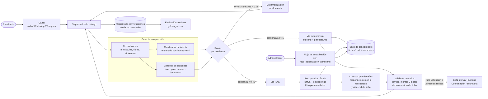
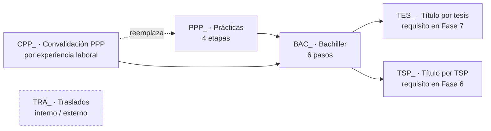

# Arquitectura híbrida del Asistente Inteligente del P.A. ISI

> Entregable del integrante A · Fase 2
> Alcance: los siete trámites del Documento Consolidado de la Fase 1 (PPP, Convalidación de PPP, Bachiller, Título por tesis, Título por TSP, Traslado interno y externo).

## 1. Por qué una arquitectura híbrida

Los trámites del P.A. tienen dos tipos de conocimiento que conviene tratar distinto:

| Tipo de consulta | Ejemplo | Mejor resuelto por |
|---|---|---|
| **Cerrada y crítica** (correo, costo, plazo, siguiente fase) | «¿a qué correo mando el plan de PPP?» | **Intents + fichas**: respuesta determinista, trazable a una ficha y a una norma |
| **Abierta o mal formulada** | «trabajo hace dos años en soporte, ¿me sirve para algo?» | **Recuperación semántica (RAG)** sobre las mismas fichas, con un modelo de lenguaje que redacta **solo** con el texto recuperado |

Un sistema solo con intents falla ante preguntas no previstas; uno solo con LLM puede inventar correos o montos. La arquitectura híbrida usa el **clasificador de intents como primera vía** y el **RAG como respaldo**, ambos alimentados por **una única base de conocimiento: las fichas**.

## 2. Vista de componentes

## 3. Componentes

| # | Componente | Responsabilidad | Entrada | Salida |
|---|---|---|---|---|
| 1 | **Canal** | Recibir y enviar mensajes | Texto del estudiante | Texto/botones |
| 2 | **Orquestador** | Mantiene el estado (intent actual, entidades, contador de intentos fallidos, ficha actual) y aplica `flujo.md` | Mensaje + estado | Acción siguiente |
| 3 | **Normalización** | Quita ruido, unifica tildes y aplica sinónimos de `entidades.yaml` | Texto | Texto normalizado |
| 4 | **Clasificador de intents** | Predice el intent con prefijo (`TES_`, `TSP_`, `PPP_`, `BAC_`, `CPP_`, `TRA_`, `GEN_`) | Texto normalizado | Intent + confianza |
| 5 | **Extractor de entidades** | Detecta fase/paso/etapa/documento | Texto | Entidades |
| 6 | **Router** | Elige vía determinista, desambiguación o RAG según la confianza | Intent, confianza | Vía |
| 7 | **Base de conocimiento** | Fichas Markdown con encabezado de metadatos (ver `esquema_metadatos.md`) | — | Fichas |
| 8 | **Recuperador híbrido** | Busca fichas por palabras clave y similitud semántica, **filtrando** por `proceso`, `estado` y `vigencia` | Consulta | Top-k fichas |
| 9 | **LLM con guardarraíles** | Redacta la respuesta usando solo las fichas recuperadas; si no hay evidencia, lo dice | Consulta + fichas | Borrador + ids citados |
| 10 | **Validador de salida** | Rechaza respuestas con correos, montos, plazos o resoluciones que no aparezcan literalmente en las fichas citadas | Respuesta | Respuesta aprobada o derivación |
| 11 | **Derivación** | `GEN_derivar_humano` (definido por F) | Contexto | Ticket/mensaje a Coordinación |
| 12 | **Registro y evaluación** | Guarda trazas anonimizadas y ejecuta el golden set tras cada cambio | Conversaciones | Métricas |

## 4. Reglas de enrutamiento

1. **Confianza alta (≥ 0.75):** vía determinista. Si falta una entidad obligatoria, se pregunta con `si_falta_entidad` del intent.
2. **Confianza media (0.40–0.75):** se ofrecen los dos intents más probables como botones (desambiguación).
3. **Confianza baja (< 0.40):** vía RAG con filtro por metadatos. Si el recuperador no supera el umbral de similitud, se cuenta como **intento fallido**.
4. **Dos intentos fallidos** en la misma conversación → `GEN_derivar_humano` (regla común del contrato, sección 3.5).
5. **Fichas pendientes:** si la ficha usada tiene `estado: pendiente`, la respuesta se envuelve en la plantilla de pendiente de cada proceso (p. ej. `PL_PENDIENTE` del proceso E) y nunca se completa el dato.
6. **Vigencia:** el recuperador descarta fichas reemplazadas (`reemplazada_por` no vacío) y prioriza la `vigencia` más reciente.

> Los umbrales 0.75 y 0.40 son valores iniciales; se calibran con el golden set (sección 7).

## 5. Ruta académica entre procesos

Las fichas se encadenan por el campo **«Siguiente fase»**, lo que permite al orquestador recorrer la cadena obligatoria descrita en el Documento Consolidado:

Los traslados son independientes de la cadena. La elección entre tesis y TSP la resuelve el intent transversal de F (elección de modalidad de título).

## 6. Guardarraíles contra datos inventados

- El LLM recibe la instrucción de **no responder nada que no esté en las fichas recuperadas** y de citar el `id` de cada ficha usada.
- El **validador de salida** extrae con expresiones regulares correos (`*@udh.edu.pe`), montos (`S/ …`), plazos (`N días`, `N meses`) y resoluciones (`Res. N.° …`) de la respuesta y verifica que cada uno exista en alguna ficha citada. Si no, la respuesta se descarta y se usa la vía determinista o la derivación.
- Los datos marcados «No indicado» o en `pendientes.md` siempre se comunican como pendientes.
- No se registran en los logs DNI, correos personales ni códigos de estudiante.

## 7. Evaluación

| Métrica | Cómo se mide | Meta inicial |
|---|---|---|
| Exactitud de intent | `intent_esperado` del golden set vs. predicho | ≥ 90 % |
| Exactitud de ficha | `ficha_esperada` vs. ficha usada | ≥ 90 % |
| Respuesta clave | `respuesta_clave` contenida en la respuesta | ≥ 95 % |
| Datos inventados | Respuestas que fallan el validador de salida | 0 |
| Derivación | % de conversaciones derivadas a humano | Seguimiento (sin meta) |

El golden set de cada proceso se ejecuta completo **antes de publicar cualquier cambio** en las fichas (ver flujo de actualización).

## 8. Pila tecnológica de referencia

La arquitectura es independiente de la herramienta. Una implementación posible, de bajo costo:

| Capa | Opción de referencia | Alternativa |
|---|---|---|
| NLU (intents/entidades) | Rasa Open Source | Dialogflow CX |
| Base de conocimiento | Repositorio GitHub (fichas Markdown) | — |
| Índice de búsqueda | Índice BM25 + embeddings en una base vectorial (p. ej. ChromaDB / pgvector) | FAISS |
| LLM | Modelo vía API con temperatura 0 | Modelo local |
| Canal | Widget web | WhatsApp Business / Telegram |

## 9. Trazabilidad con el contrato

| Elemento del contrato | Dónde lo usa la arquitectura |
|---|---|
| `fichas/*.md` (3.3) | Base de conocimiento única para ambas vías |
| `intents.yaml` (3.4) | Entrenamiento del clasificador; `si_falta_entidad` en el orquestador |
| `flujo.md` (3.5) | Lógica del orquestador por proceso |
| `plantillas.md` | Respuestas de la vía determinista |
| `golden_set.csv` (3.6) | Evaluación de regresión |
| `pendientes.md` (3.7) | Marca de datos no publicables como confirmados |
| Prefijos (3.2) | Espacio de nombres de intents, fichas y router por proceso |
