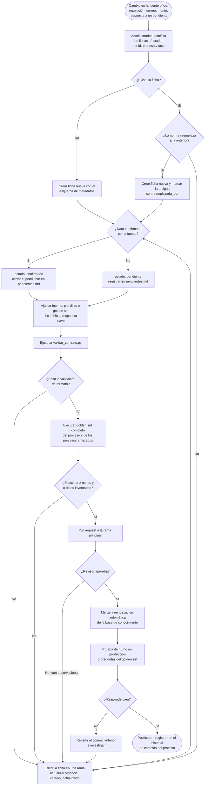

# Flujo de actualización de la base de conocimiento por el administrador

> Entregable del integrante A · Fase 2

Cuando cambia un dato oficial (nueva resolución, nuevo correo, nuevo monto, respuesta de Coordinación a un pendiente), el administrador **no edita respuestas del chatbot**: edita **la ficha**. Todo lo demás (índice, plantillas, evaluación) se regenera a partir de ella.

## 1. Roles

| Rol | Quién | Qué hace |
|---|---|---|
| **Fuente** | Coordinación del P.A. ISI / Facultad | Emite o confirma el dato oficial |
| **Administrador** | Responsable del asistente | Edita fichas, ejecuta validaciones, publica |
| **Revisor** | Responsable del proceso afectado (B–F) o Coordinación | Aprueba el cambio antes de publicarlo |
| **Sistema** | Validador + indexador + golden set | Comprueba formato, reindexa y evalúa |

## 2. Diagrama del flujo

## 3. Pasos detallados

1. **Detectar el cambio.** Fuentes posibles: nueva resolución, comunicado de Coordinación, respuesta a un ítem de `pendientes.md`, o un patrón de derivaciones a humano en los registros que revela un dato desactualizado.
2. **Localizar las fichas.** Buscar por `id`, `proceso` y texto (p. ej. un correo que cambió puede aparecer en varias fichas: `secretaria.sistemas.hco@udh.edu.pe` se usa en PPP, convalidación de PPP y título).
3. **Editar en una rama** del repositorio, nunca directamente en la rama principal.
4. **Actualizar metadatos:** `vigencia` (fecha de la nueva norma), `fuente`, `estado`, y los opcionales `version` (+1), `actualizado`, `actualizado_por`.
5. **Actualizar `pendientes.md`:** cerrar el pendiente resuelto (indicar fecha y fuente) o agregar uno nuevo.
6. **Revisar artefactos dependientes:** si cambia una respuesta clave, actualizar `golden_set.csv` y la plantilla correspondiente; si aparece una consulta nueva frecuente, agregar ejemplos al intent.
7. **Validar formato** con `python validar_contrato.py <carpeta_del_proceso>`.
8. **Evaluar** con el golden set. Ningún cambio se publica si aparece un dato no respaldado.
9. **Revisión** por el responsable del proceso o Coordinación mediante pull request.
10. **Publicar:** merge → reindexación → prueba de humo. Si falla, revertir.

## 4. Reglas

- Un cambio = una rama = un pull request, con el `id` de las fichas en el título (p. ej. `CPP_E01: monto del derecho de trámite`).
- Nunca borrar una ficha con normativa histórica: marcarla con `reemplazada_por`.
- No publicar con `estado: confirmado` un dato que solo se conoce de forma verbal; requiere documento o correo oficial de Coordinación citado en `fuente`.
- Los cambios urgentes (p. ej. un correo dado de baja) siguen el mismo flujo, pero la revisión puede hacerla directamente Coordinación.
