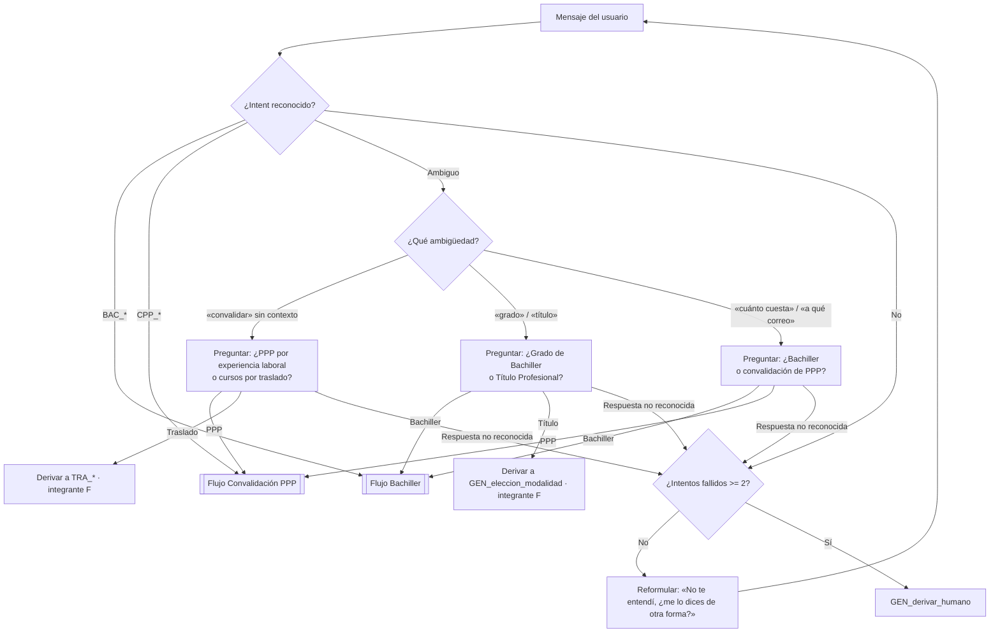
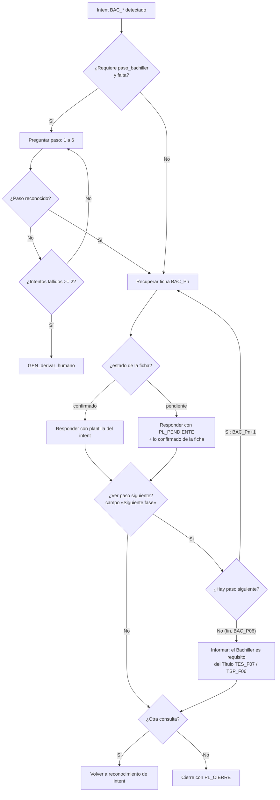
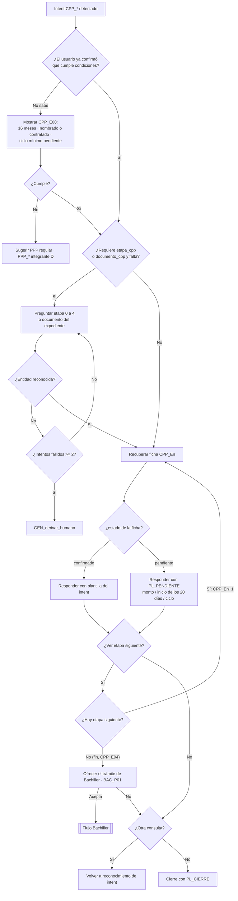

# Flujo conversacional — Proceso E: Grado de Bachiller y Convalidación de PPP

Contempla lo exigido en el contrato (sección 3.5): desambiguación, solicitud de entidades faltantes, respuesta basada en ficha, seguimiento a pasos o etapas posteriores, cierre y derivación a `GEN_derivar_humano` tras **dos intentos fallidos**.

Convenciones:

- Un **intento fallido** es una respuesta del usuario que no permite reconocer el intent o la entidad pedida. El contador es por conversación y se reinicia al responder con una ficha.
- Si la ficha tiene `estado: pendiente`, la respuesta usa la plantilla `PL_PENDIENTE` y nunca completa el dato faltante.

## 1. Entrada y desambiguación entre procesos

## 2. Flujo del Grado de Bachiller

## 3. Flujo de la Convalidación de PPP por experiencia laboral

## 4. Reglas de decisión

| Situación | Acción del sistema | Plantilla |
|---|---|---|
| Intent BAC/CPP reconocido con todas sus entidades | Responder con la ficha | La del intent |
| Falta entidad obligatoria (`paso_bachiller`, `etapa_cpp`, `documento_cpp`) | Preguntar con el texto `si_falta_entidad` | `PL_FALTA_ENTIDAD` |
| `tipo_foto` no indicada | Mostrar ambas fotos (no se considera intento fallido) | `PL_BAC_FOTOS` |
| Ficha con `estado: pendiente` | Responder lo confirmado y declarar el dato pendiente | `PL_PENDIENTE` |
| «Convalidar» sin contexto | Desambiguar PPP vs. traslado | `PL_DESAMBIGUAR` |
| Usuario pide «siguiente» / «y luego» | Seguir el campo «Siguiente fase» de la ficha | La del intent |
| 2 intentos fallidos consecutivos | Derivar | `GEN_derivar_humano` |
| Usuario pide hablar con una persona | Derivar de inmediato | `GEN_derivar_humano` |
