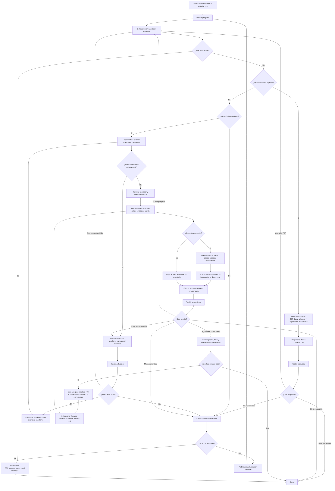
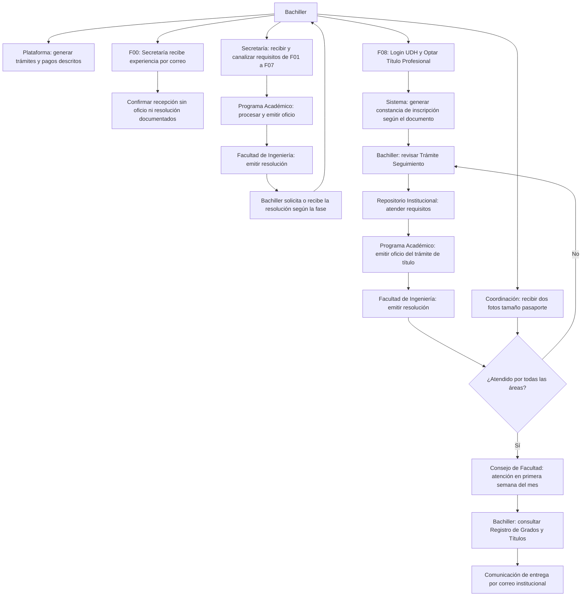

# Flujos del Trabajo de Suficiencia Profesional

## Fuente, alcance y estado de verificación

Se leyó completo `TrabajoSuficiencia.md` (secciones 1–20) y se contrastaron el prerrequisito, las fases, los diagramas de secuencia, los checklists y las tablas consolidadas. El texto de instrucciones fija el contrato de archivos; la fuente administrativa es únicamente ese Markdown. No se usaron procedimientos de tesis ni de traslados para completar datos del TSP.

Las fichas conservan los hechos documentados con `estado: pendiente` y `vigencia: no indicada`, porque no se ha recibido validación institucional actual. No se inventan direcciones de Secretaría, porcentajes de originalidad ni condiciones de aprobación de sustentación.

Puntos que requieren aclaración: la ubicación de la evaluación de 15 días respecto de la designación de jurados de F02; la identificación exacta de la “resolución de aprobación” requerida en F04; la diferencia entre recepción y validación de experiencia; y el momento de generación de la constancia automática de F08 respecto de la atención completa del Repositorio. Se mantienen las formulaciones de la fuente y se registran las preguntas en `pendientes.md`.

El origen de cada ficha se identifica por sección: F00 en 3; F01–F08 en 4–11. La regla general de seguimiento procede expresamente de 11.2: todos los trámites tienen seguimiento desde Login UDH, principalmente en Trámite Seguimiento. Consulta Registro de Grados y Títulos se describe para F08. No se afirma que el chatbot acceda al expediente.

## 1. Flujo conversacional principal

El contador aumenta únicamente al recibir un mensaje incomprensible o una respuesta inválida a una aclaración. La primera pregunta para completar una entidad no consume un fallo. El contexto guarda modalidad, fase/etapa activa, intención pendiente, entidades y oferta de continuidad. Una aclaración como “la 6” completa la consulta anterior de costo.



La solicitud explícita de persona la resuelve el orquestador común. El módulo C no define ni entrena `GEN_derivar_humano`. Al referenciarlo, utilizar `TSP_P13` como texto local de transición y dejar la orientación global al módulo propietario. No se afirma que se haya transferido una conversación.

Si falta el correo de Secretaría, se entiende la consulta y se informa la ausencia: no es un fallo de comprensión. Si el estudiante pregunta por la fase 5 y luego por su costo, se conserva esa fase; si pregunta expresamente por otra, la fase explícita sustituye el contexto anterior. “Jurados” sin contexto solicita elegir F02 o F04. “Informe final” sin acción no basta para seleccionar una fase.

## 2. Secuencia administrativa documentada

Este diagrama describe el trámite, no decisiones del chatbot. Las condiciones administrativas se explican sin certificar que el bachiller las haya cumplido. En F02 se preserva la secuencia de la fuente y se advierte que la ubicación precisa de la revisión respecto de la designación está pendiente. Los dos meses de F04 son para subsanar, no un plazo de evaluación.

```mermaid
flowchart TD
    A["TSP_F00: acreditar dos años de experiencia"] --> R["Secretaría confirma recepción; validación de fondo por precisar"]
    R --> B["TSP_F01: designación del docente asesor"]
    B --> C["TSP_F02: designación de jurados y evaluación descrita"]
    C --> EV["Evaluación máxima de quince días; tipo de días no indicado"]
    EV --> O2{"¿Existen observaciones?"}
    O2 -->|Sí| S2["Subsanar: máximo dos meses"]
    S2 --> AT2["Atender observaciones según la fuente; detalle pendiente"]
    O2 -->|No| D["TSP_F03: aprobación del trabajo"]
    AT2 --> D
    D --> EXE["Ejecutar con asesor técnico: mínimo dos y máximo seis meses"]
    EXE --> E["TSP_F04: jurados para el informe final"]
    E --> O4{"¿Existen observaciones?"}
    O4 -->|Sí| S4["Subsanar: máximo dos meses"]
    S4 --> AT4["Atender observaciones; sin regla de reevaluación inventada"]
    O4 -->|No| F["TSP_F05: aprobación del informe final"]
    AT4 --> F
    F --> G["TSP_F06: declarar apto para sustentación"]
    G --> H["TSP_F07: programar fecha y hora"]
    H --> SUS["Realizar sustentación"]
    SUS --> I["TSP_F08: Optar Título Profesional en Login UDH"]
    I --> AUTO["Constancia automática según la fuente; revisar requisitos en seguimiento"]
    AUTO --> REPO["Atención de Repositorio y presentación de dos fotos en Coordinación"]
    REPO --> AREAS{"¿Todas las áreas atendieron el trámite?"}
    AREAS -->|No| SEG["Consultar seguimiento y atender lo solicitado"]
    SEG --> REPO
    AREAS -->|Sí| CONS["Consejo de Facultad: primera semana de cada mes"]
    CONS --> REG["Consultar Registro de Grados y Títulos"]
    REG --> ENT["Comunicación por correo institucional y entrega aproximada en dos meses"]
```



## 3. Responsabilidades administrativas

La rama general cubre las fases 1–7. F00 es recepción de experiencia por correo en Secretaría. F08 tiene su ruta específica con Repositorio y Consejo; no se impone a esa fase una nueva entrega de expediente a Secretaría que la fuente no detalle. Programa Académico emite oficios y Facultad de Ingeniería emite resoluciones.



El arco Secretaría → Programa se refiere a canalización de expedientes administrativos; para F00 solo se documenta confirmación de recepción y no se afirma oficio ni resolución. Los dos mecanismos de seguimiento son orientaciones al bachiller, sin una integración que permita al chatbot verificar el estado.

## Casos conversacionales de integración

| Caso | Entrada y contexto | Resolución esperada |
|---|---|---|
| A | ¿Qué necesito para la fase 3? | TSP_requisitos_fase, TSP_F03, TSP_P01; listar los tres requisitos sin añadir informe final. |
| B | ¿Cuánto cuesta? → La fase 6 | Guardar TSP_costo_fase; pedir fase; completar fase=6; TSP_F06 y TSP_P03 con el pago documentado. |
| C | Quiero saber sobre los jurados | Preguntar F02 o F04; no elegir arbitrariamente. |
| D | Ya terminé la fase 3, ¿qué sigue? | Explicar ejecución posterior de dos a seis meses con asesor técnico y continuación a F04; no saltar automáticamente la ejecución. |
| E | Me hicieron observaciones, ¿cuánto tiempo tengo? | Pedir fase; F02/F04 tienen subsanación máxima de dos meses; F08 no especifica ese plazo. |
| F | ¿Cuál es el correo de Secretaría? | TSP_contacto; indicar correo no incluido en fuente, sin reutilizar el de Repositorio. |
| G | Quiero hacer título por tesis | TSP_fuera_alcance y TSP_P16; no usar procedimientos TSP para tesis. |
| H | Dos respuestas incomprensibles consecutivas | Referenciar GEN_derivar_humano sin definirlo localmente. |
| I | Requisitos de fase 5 → ¿Y cuánto cuesta? | Conservar fase=5; TSP_costo_fase, TSP_F05 y TSP_P03. |

Estos casos especifican comportamiento para la implementación futura. No se presenta un chatbot funcional ni se afirma haber evaluado un clasificador.

## Mapa de navegación

| Unidad activa | Unidad siguiente | Condición que debe conservar la respuesta |
|---|---|---|
| `TSP_F00` | `TSP_F01` | Cumplir el prerrequisito para iniciar F01. La confirmación de recepción no acredita por sí sola una validación de fondo; el mecanismo de acreditación requiere precisión institucional. |
| `TSP_F01` | `TSP_F02` | Obtener la resolución de designación para continuar a F02. |
| `TSP_F02` | `TSP_F03` | Atender las observaciones que correspondan y obtener la resolución según la fuente antes de continuar a F03. |
| `TSP_F03` | `TSP_F04` | Después de la resolución de aprobación, ejecutar el trabajo bajo orientación del asesor técnico durante el periodo documentado; finalizada la ejecución se continúa a F04. |
| `TSP_F04` | `TSP_F05` | Subsanar las observaciones del informe final que correspondan antes de solicitar su aprobación en F05. |
| `TSP_F05` | `TSP_F06` | Con el informe final aprobado, continuar con la declaración de aptitud en F06. |
| `TSP_F06` | `TSP_F07` | Con la resolución de apto, solicitar la programación en F07. |
| `TSP_F07` | `TSP_F08` | Obtener la programación y realizar la sustentación antes de continuar con F08. No se documentan aquí condiciones de aprobación ni un acta adicional obligatoria. |
| `TSP_F08` | Fin documentado | Fin del proceso documentado: mantener seguimiento hasta la comunicación y entrega. No hay F09. |

## Contratos de integración

`intents.yaml` es un objeto con entidades, políticas, dependencias externas y la lista `intents`. La lista no contiene GEN_derivar_humano. Las fichas candidatas son IDs concretos y existentes; se filtran por consulta y fase. `fase=0` en metadatos identifica el prerrequisito, mientras que la entidad de fase administrativa solo admite del 1 al 8; `etapa=0` recupera TSP_F00.

`golden_set.csv` usa UTF-8 con BOM para facilitar la apertura en Excel y mantiene exactamente las cinco columnas y quince registros pactados. En una desambiguación, `ficha_esperada` contiene las fichas candidatas separadas por `|` dentro de la misma celda. No se inventa un ID para aclaración. Una celda con varias fichas indica que debe preguntarse antes de responder sus datos.

Las variables de plantilla se extraen de las fichas; los ejemplos concretos son demostrativos y deben contrastarse con ellas. La regla de navegación de F03 y F07 prevalece sobre una oferta genérica de fase siguiente. Todo contacto o monto se muestra como documentado con vigencia pendiente.

## Inventario final y control de integridad

```text
fase2/
└── titulo_tsp/
    ├── fichas/
    │   ├── TSP_F00.md
    │   ├── TSP_F01.md
    │   ├── TSP_F02.md
    │   ├── TSP_F03.md
    │   ├── TSP_F04.md
    │   ├── TSP_F05.md
    │   ├── TSP_F06.md
    │   ├── TSP_F07.md
    │   └── TSP_F08.md
    ├── intents.yaml
    ├── flujo.md
    ├── plantillas.md
    ├── golden_set.csv
    └── pendientes.md
```

| Componente | Cantidad |
|---|---:|
| Archivos del contrato | 14 |
| Prerrequisito | 1 |
| Fases administrativas | 8 |
| Intents locales | 16 |
| Ejemplos por intent | 10 |
| Ejemplos de intents en total | 160 |
| Entidades | 8 |
| Ejemplos por entidad | 10 |
| Diagramas Mermaid | 3 |
| Plantillas completas | 21 |
| Preguntas del Golden Set | 15 |
| Pendientes de validación | 32 |

La validación automatizada comprobó los campos y secciones de las nueve fichas, parseo de YAML, unicidad de identificadores, diez ejemplos distintos por intent, existencia de referencias y enlaces, coherencia de siguientes fases, catorce archivos obligatorios, encabezado y cinco columnas del CSV, quince registros correlativos, importes de cada fase, plazos y periodicidades documentados y formatos Word/PDF. Se contrastaron las cantidades clave del Golden Set y la referencia exclusiva, sin definición local, a GEN_derivar_humano.

Los tres diagramas pasaron una comprobación estructural local de la gramática empleada, definiciones de nodos, conexiones y alcanzabilidad desde el inicio. No se ejecutó un renderizador Mermaid ni se verificó su visualización en GitHub o VS Code. El Golden Set especifica respuestas esperadas; no representa una evaluación de un chatbot implementado.

La comparación de huellas SHA-256 de los 19 archivos existentes de traslados confirmó que permanecen intactos. No se modificó la carpeta de otro integrante. Los scripts temporales de generación y verificación no se incluyen en el paquete del módulo C.
