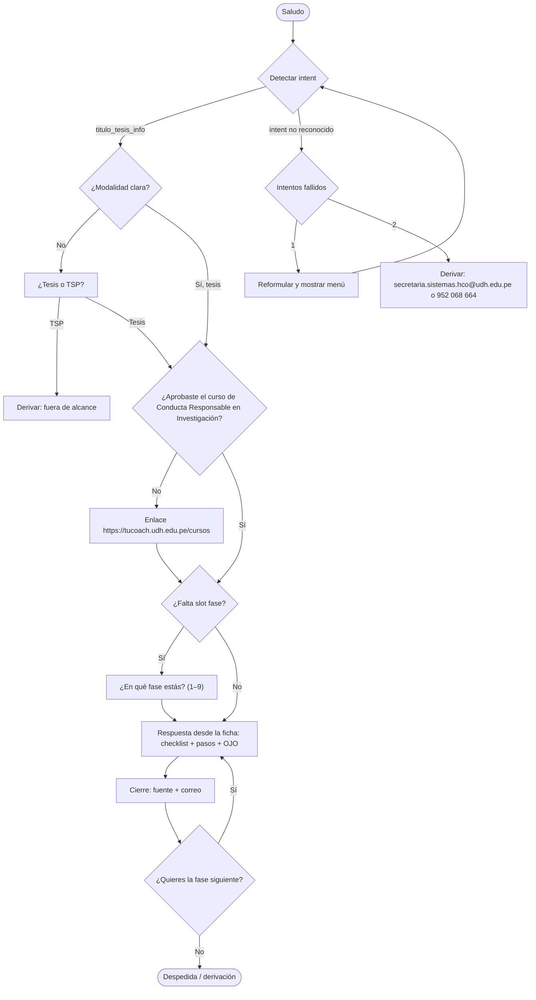
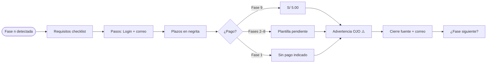

# Paso 4 — Flujos conversacionales

**Tono:** tú · **Máx.:** 6 líneas + checklist · **Cierre:** fuente + correo.

## 4.1 Árbol maestro (`titulo_tesis_info`)

## 4.2 Ramas obligatorias

| # | Rama | Disparador | Respuesta |
|---|------|-----------|-----------|
| R1 | Desambiguación de modalidad | "quiero mi título" sin modalidad | "¿Por **tesis** o por **TSP**?" → Tesis: continúa · TSP: deriva (fuera de alcance). |
| R2 | Prerrequisito CRC | Antes de Fase 1 | "¿Ya aprobaste el curso de Conducta Responsable en Investigación?" → No: https://tucoach.udh.edu.pe/cursos. |
| R3 | Validación de bachiller | Fase 7 (y 8) | "¿Ya tienes el grado de bachiller? Es requisito para declarar apto." |
| R4 | Desambiguación de fase | "el informe" | "¿Informe de proyecto (Fase 3), informe final (Fase 5) o pre sustentación (Fase 6)?" |
| R5 | Fallback | 2 intentos fallidos | Derivar a secretaria.sistemas.hco@udh.edu.pe o 952 068 664. |
| R6 | Pendientes | Monto Fases 2–8 o boleta de pago Fase 7 | "Ese dato no está confirmado en el reglamento vigente. Consulta a secretaria.sistemas.hco@udh.edu.pe." |
| R7 | Seguimiento | "cómo va mi trámite" | Login → **Trámite Seguimiento**; Fase 9 → **CONSULTA REGISTRO DE GRADOS Y TITULOS**. |

## 4.3 Subárbol común por fase

## 4.4 Subárboles específicos por fase

| Fase | Validaciones / preguntas propias | Particularidades |
|------|----------------------------------|------------------|
| 1 | R2 (CRC). "¿Harás la tesis en pareja?" → sí: compromiso de honor. | Plazo 1–4 meses; si no cumple → se anula. Asesor: 2 años / 1 año. Sin pago indicado. |
| 2 | "¿Tienes resolución de asesores e informe de conformidad?" | Plazo 1–4 meses va dentro del requisito. Monto → R6. |
| 3 | "¿Tu constancia de originalidad la emitió el asesor técnico?" | 2–6 meses. Trabajo en PDF. Monto → R6. |
| 4 | "¿Tienes el instrumento de evaluación del asesor?" | 30 días, máx. 2 revisiones. Monto → R6. |
| 5 | "¿Tu informe fue observado?" → 30 días, máx. 2 revisiones. | Monto → R6. |
| 6 | "¿Tu informe quedó observado?" → 15 días + informe de conformidad del asesor técnico a secretaria.sistemas.hco@udh.edu.pe. | Requisito: aprobación de los tres jurados. Monto → R6. |
| 7 | R3 (bachiller). "¿Hubo observaciones en pre sustentación?" → añadir informe del asesor. | DNI ampliada ambas caras + antecedentes penales. Boleta de pago y monto → R6. |
| 8 | "¿Cuándo pediste DECLARAR APTO?" → máx. 30 días. | Monto → R6. |
| 9 | "¿Ya pagaste S/ 5.00?" · "¿Ya enviaste lo del Repositorio?" · "¿Tu trámite fue atendido por todas las áreas?" | Consejo: 1.ª semana del mes. Grado: ~2 meses. 2 fotos pasaporte. Requisitos de Repositorio detallados en Trámite Seguimiento (pendiente). |

## 4.5 Ejemplo de respuesta (Fase 6, ≤ 6 líneas + checklist)

> Para la **Fase 6 – Pre sustentación** necesitas:
> - [ ] Aprobación del informe final de los tres jurados
> - [ ] Resolución de aprobación del proyecto de investigación
> - [ ] Trabajo de investigación
>
> Genera el trámite **PRE SUSTENTACION DEL INFORME DE TESIS** en Login y envía todo a secretaria.sistemas.hco@udh.edu.pe.
> ⚠️ **OJO:** si queda observado, subsana en máximo **15 días** y envía el informe de conformidad de tu asesor técnico.
> El monto del trámite no está confirmado: consulta a secretaria.sistemas.hco@udh.edu.pe.
> Fuente: Resolución N.° 2367-2025-R-CU-UDH. ¿Quieres la fase siguiente?
