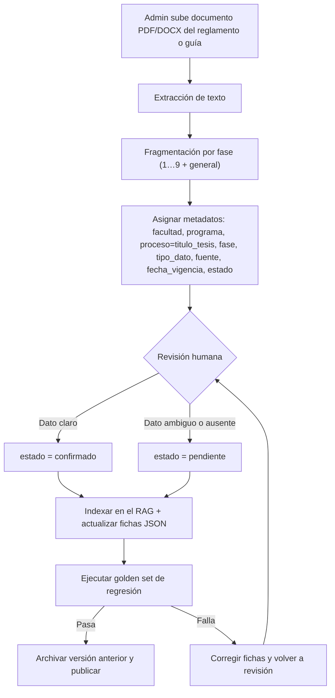

# Paso 6 — Flujo de actualización de la base de conocimiento

## Responsables
| Rol | Responsabilidad |
|-----|-----------------|
| **Coordinación del Programa (Ing. de Sistemas e Informática)** | Aprobar el contenido y resolver los puntos `pendiente` (montos, boleta de pago, requisitos del Repositorio). |
| **Secretaría del Programa** | Verificar correos, teléfonos, trámites de Login y plazos operativos. |
| **Administrador del bot** | Subir documento, ejecutar indexación y el golden set, archivar la versión anterior. |

## Frecuencia de reindexación
- **Obligatoria:** cada vez que cambie el reglamento o la Resolución (nuevo documento).
- **Programada:** revisión al inicio de cada semestre académico.
- **Ante cambio de datos exactos** (monto, correo, teléfono): actualización inmediata de la ficha JSON.

## Versionado
`vAAAA.MM.DD` por documento fuente. Versión vigente: **v2025.11.11** (Resolución N.° 2367-2025-R-CU-UDH). Las versiones anteriores se archivan, no se borran.
