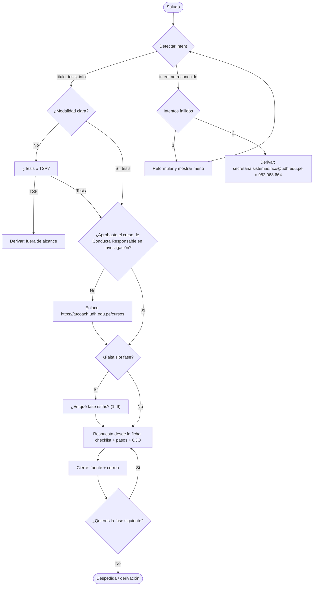
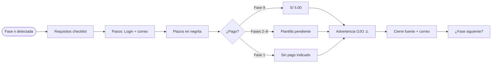
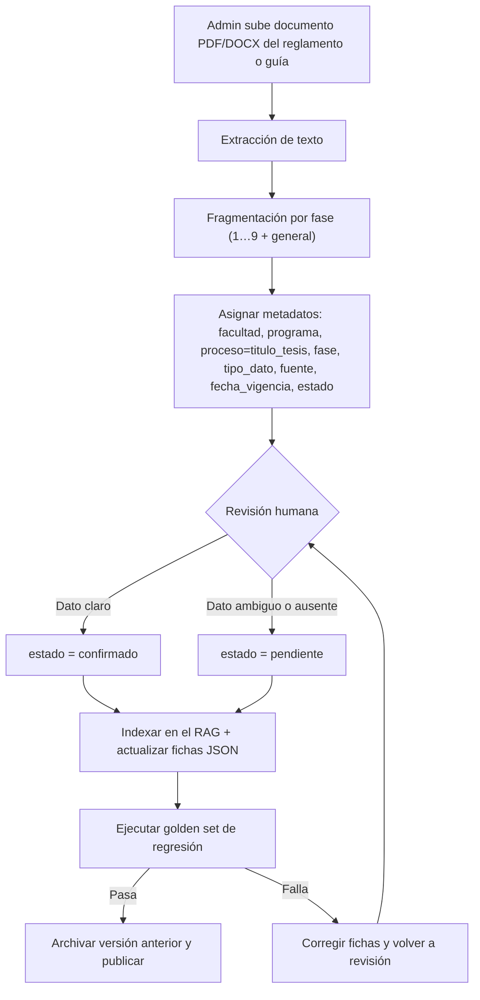

# Entregable Fase 2 — Bot de Título por Tesis (UDH · Ing. de Sistemas e Informática)

**Fuente:** Resolución N.° 2367-2025-R-CU-UDH (11-nov-2025) · **Tono:** tú · **Respuesta:** máx. 6 líneas + checklist

## Contenido
0. Decisión de arquitectura · 1. Taxonomía y metadatos · 2. Fichas de conocimiento (JSON) · 3. Catálogo de intents · 4. Flujos conversacionales · 5. Plantillas · 6. Flujo de actualización · 7. Golden set (CSV) · 8. Validación pendiente

---

# Paso 0 — Decisión de arquitectura

**Proceso:** Optar Título Profesional – Modalidad Sustentación de Tesis
**Programa:** Ingeniería de Sistemas e Informática – Facultad de Ingeniería – UDH
**Fuente:** Resolución N.° 2367-2025-R-CU-UDH (11-nov-2025)

## 1. Arquitectura híbrida confirmada

| Capa | Función en este proceso |
|------|-------------------------|
| **Intents** | Detectar que el estudiante pregunta por "título por tesis" y en qué fase está (`titulo_tesis_info`, `titulo_tesis_fase`, transversales). |
| **RAG** | Responder con el contenido narrativo de las fichas (requisitos, pasos, advertencias) generadas desde `Proceso_Optar_Titulo_MST.md`. |
| **Fichas JSON estructuradas** | Datos exactos que **no se deben generar con el LLM**: correos, teléfonos, montos, plazos, nombres exactos de trámites en Login. |

Regla de prioridad: **dato exacto → ficha JSON; explicación → RAG; nunca inventar**. Si el dato es `pendiente`, se usa la plantilla de dato no confirmado.

Datos exactos que viven en JSON:
- Correos: `secretaria.sistemas.hco@udh.edu.pe` (Fases 1–8), `repositorio@udh.edu.pe` (Fase 9).
- Montos: **S/ 5.00** (solo Fase 9). Fases 2–8: "monto establecido" → `pendiente`.
- Plazos: 1 mes, 4 meses, 2 meses, 6 meses, 30 días, 15 días, 2 años, 1 año, ~2 meses (entrega de grado).
- Trámites Login (nombre exacto, en mayúsculas) y teléfonos: **952 068 664** (consulta Fase 9) y **952069136** (pie de página).

## 2. Tono
**Tuteo ("tú").** Cercano y claro, sin jerga institucional innecesaria. Ejemplo: "Necesitas…", "Envía los requisitos a…".

## 3. Longitud máxima de respuesta
**6 líneas de texto + checklist.** El checklist (`- [ ]`) no cuenta dentro de las 6 líneas. Si hay más contenido, el bot ofrece: "¿Quieres que te detalle los pasos o la siguiente fase?".

## 4. Unidad de fragmentación
**10 fichas:** 1 ficha **General** + 1 ficha por cada una de las **9 fases**.

La ficha General contiene: base normativa, objetivo, indicación previa (curso Conducta Responsable en Investigación), contactos (2 correos, 2 teléfonos, dirección), seguimiento en Login, Consejo de Facultad, entrega del grado y áreas de atención.

## 5. Reglas de contenido
1. Las advertencias **"OJO"** se conservan tal cual (son contenido a comunicar).
2. Las observaciones del apartado 11 del documento **no se corrigen**; se registran como `estado: pendiente` o como nota.
3. Cada respuesta cierra con la fuente (Resolución N.° 2367-2025-R-CU-UDH) y el correo destino.
4. Fuera de alcance: TSP, PPP, bachiller, convalidación → se deriva.


---

# Paso 1 — Taxonomía y esquema de metadatos

## Jerarquía

```text
Facultad: Ingeniería
 └─ Programa: Ingeniería de Sistemas e Informática
     └─ Proceso: Optar Título Profesional – Modalidad Sustentación de Tesis
         └─ Fase: 1 … 9  (+ "general")
             └─ {requisito, paso, pago, plazo, correo, actor, anexo, advertencia}
```

## Esquema de metadatos por fragmento

| Campo | Valores | Ejemplo |
|-------|---------|---------|
| `facultad` | Ingeniería | Ingeniería |
| `programa` | Ingeniería de Sistemas e Informática | idem |
| `proceso` | `titulo_tesis` | titulo_tesis |
| `fase` | 1…9 / `general` | 4 |
| `tipo_dato` | requisito \| paso \| pago \| plazo \| correo \| actor \| anexo \| advertencia | plazo |
| `fuente` | Resolución N.° 2367-2025-R-CU-UDH (11-nov-2025) | idem |
| `fecha_vigencia` | 2025-11-11 | 2025-11-11 |
| `estado` | confirmado \| pendiente | pendiente |

## Ejemplo de fragmento

```json
{
  "facultad": "Ingeniería",
  "programa": "Ingeniería de Sistemas e Informática",
  "proceso": "titulo_tesis",
  "fase": 7,
  "tipo_dato": "requisito",
  "texto": "Boleta de pago.",
  "fuente": "Resolución N.° 2367-2025-R-CU-UDH (11-nov-2025)",
  "fecha_vigencia": "2025-11-11",
  "estado": "pendiente"
}
```

## Reglas
- `estado = pendiente` cuando el documento no especifica el dato (montos Fases 2–8, boleta de pago Fase 7, requisitos del Repositorio, etc.).
- Todo fragmento lleva los 8 metadatos; sin metadatos completos no se indexa.


---

# Paso 2 — Fichas de conocimiento

Archivo completo: `2_fichas_conocimiento.json` (10 fichas: general + fases 1–9, con metadatos por fragmento).

| Ficha | Trámite Login | Pago | Plazo clave | Estado |
|---|---|---|---|---|
| General | — | — | Consejo 1.ª semana del mes; grado ~2 meses | confirmado (áreas que atienden: pendiente) |
| Fase 1 | DESIG. DE DOCENTE ASESOR TECNICO PARA LA TESIS | sin pago indicado | Vigencia del trámite: mínimo 1 mes, máximo 4 meses. | pendiente (pago) |
| Fase 2 | DESIG. DE DOC. OBJETANTE PARA LA REVISION DEL TRAB. DE INV. (TESIS) | monto establecido (sin cifra) | El proceso del informe de conformidad del proyecto es de mínimo 1 mes y máximo 4 meses (aparece dentro del requisito). | pendiente (pago) |
| Fase 3 | APROBACION DEL TRABAJO DE INVESTIGACION (TESIS) | monto establecido (sin cifra) | Duración mínima 2 meses, máxima 6 meses. | pendiente (pago) |
| Fase 4 | DESIGNACION DE JURADOS REVISORES DEL INFORME FINAL (TESIS) | monto establecido (sin cifra) | Plazo máximo de 30 días. | pendiente (pago) |
| Fase 5 | APROBACION DEL INFORME FINAL (TESIS) | monto establecido (sin cifra) | Plazo máximo de 30 días para atender y subsanar observaciones. | pendiente (pago) |
| Fase 6 | PRE SUSTENTACION DEL INFORME DE TESIS | monto establecido (sin cifra) | Si el informe queda observado: subsanar máximo en 15 días y enviar el informe de conformidad (aprobación) del asesor técnico. | pendiente (pago) |
| Fase 7 | DECLARAR APTO PARA SUSTENTACION | monto establecido (sin cifra) | El documento no especifica un plazo propio para esta fase. | pendiente (pago) |
| Fase 8 | FECHA Y HORA | monto establecido (sin cifra) | Plazo máximo de 30 días para solicitar fecha y hora, contados desde que solicitaste DECLARAR APTO. | pendiente (pago) |
| Fase 9 | OPTAR TÍTULO PROFESIONAL (MODALIDAD DE SUSTENTACION DE TESIS) | S/ 5.00 | Consejo de Facultad: primera semana de cada mes. | confirmado |

---

# Paso 3 — Catálogo de intents y entidades

## 3.1 Intents

### Generales
saludo · despedida · agradecimiento · menu_ayuda · hablar_con_humano · fuera_de_alcance · fallback

### Propios del proceso
titulo_tesis_info · titulo_tesis_fase

### Transversales
consultar_requisitos · consultar_costo · consultar_plazo · consultar_correo · consultar_estado_tramite · elegir_modalidad_titulo · ruta_academica

> Excluidos (no son este proceso): `ppp_info`, `conv_ppp_experiencia`, `bachiller_info`, `titulo_tsp_info`, `convalidacion_traslado`.

## 3.2 Entidades

| Entidad | Valores |
|---------|---------|
| `fase` | 1–9, general |
| `modalidad_titulo` | tesis, TSP |
| `documento` | carta de aceptación, constancia CRC, compromiso de honor, resolución de asesores, informe de conformidad, constancia de originalidad, instrumento de evaluación, informe final, boleta de pago, DNI, antecedentes penales, constancia de repositorio, fotos |
| `tramite_login` | nombre exacto en mayúsculas (ver fichas) |
| `programa` | Ingeniería de Sistemas e Informática |

## 3.3 Tabla intent | frases_ejemplo | entidades

| intent | frases_ejemplo | entidades_que_extrae |
|--------|----------------|----------------------|
| saludo | "hola" · "buenas" · "buenos días" · "hola, una consulta" · "qué tal" · "buenas tardes" · "hey" · "hola bot" · "holi" · "buenas noches" | — |
| despedida | "chau" · "adiós" · "hasta luego" · "nos vemos" · "eso es todo" · "ya me voy" · "gracias, chau" · "listo, hasta pronto" · "cerrar" · "bye" | — |
| agradecimiento | "gracias" · "muchas gracias" · "te agradezco" · "genial, gracias" · "ok gracias" · "súper, gracias" · "mil gracias" · "buenazo" · "gracias por la ayuda" · "perfecto, gracias" | — |
| menu_ayuda | "qué puedes hacer" · "ayuda" · "menú" · "qué temas manejas" · "en qué me ayudas" · "opciones" · "qué sabes de titulación" · "cómo funciona esto" · "necesito ayuda" · "qué información tienes" | — |
| hablar_con_humano | "quiero hablar con alguien" · "pásame con secretaría" · "necesito una persona" · "comunícame con coordinación" · "hay alguien real" · "con quién coordino" · "quiero un humano" · "atiéndanme por teléfono" · "no me sirve, quiero hablar con alguien" · "número de contacto" | programa |
| fuera_de_alcance | "cuánto es la pensión" · "cuándo son las matrículas" · "dónde queda la biblioteca" · "cómo me convalido" · "qué es el PPP" · "cómo saco mi bachiller" · "cuál es el clima" · "recomiéndame una película" · "ayúdame con mi tarea" · "horario de clases" | — |
| fallback | "asdf" · "no sé" · "eso" · "mmm" · "xyz123" · "lo de siempre" · "pues" · "a ver" · "quizás" · "tal vez" | — |
| titulo_tesis_info | "quiero mi título por tesis" · "cómo me titulo con tesis" · "proceso de titulación" · "quiero sustentar mi tesis" · "cómo saco el título profesional" · "qué pasos hay para titularme" · "titulación por tesis sistemas" · "por dónde empiezo para titularme" · "cuántas fases tiene el proceso" · "quiero titularme" · "cómo es el trámite de título" · "explícame el proceso de tesis" | modalidad_titulo, programa |
| titulo_tesis_fase | "qué necesito para la fase 4" · "ya tengo asesor, qué sigue" · "estoy en pre sustentación" · "ya declaré apto, y ahora" · "qué sigue después del informe final" · "en qué consiste la fase 6" · "voy por la fase 3" · "ya aprobaron mi proyecto, qué hago" · "estoy en la fase de jurados" · "cuál es la fase 9" · "qué viene después de la pre sustentación" · "ya tengo fecha de sustentación, qué falta" | fase, tramite_login |
| consultar_requisitos | "qué documentos necesito" · "requisitos para designar asesor" · "qué papeles piden para declarar apto" · "qué es el doc objetante" · "qué es la constancia de originalidad" · "necesito compromiso de honor" · "piden DNI en alguna fase" · "qué piden para fecha y hora" · "lista de requisitos fase 2" · "qué adjunto al trámite" · "requisitos para el título" | fase, documento |
| consultar_costo | "cuánto cuesta la pre sustentación" · "cuánto se paga en declarar apto" · "cuánto cuesta el título" · "hay que pagar en la fase 3" · "monto de la fase 4" · "cuánto es el trámite de fecha y hora" · "qué es la boleta de pago" · "cuánto pago por optar título" · "tiene costo designar asesor" · "cuánto cuesta jurados revisores" · "precio del trámite" | fase, documento |
| consultar_plazo | "cuántos días tengo para subsanar" · "cuánto demora la aprobación del proyecto" · "plazo para pedir fecha y hora" · "cuánto dura la fase 1" · "cuándo es el Consejo de Facultad" · "cuánto tarda la entrega del grado" · "cuántas revisiones me dan" · "hasta cuándo vale mi asesor" · "cuántos meses tengo en la fase 3" · "se anula mi trámite si me demoro" · "tiempo para levantar observaciones" | fase |
| consultar_correo | "dónde mando los papeles" · "a qué correo envío los requisitos" · "correo de secretaría" · "correo del repositorio" · "a quién le escribo" · "número para consultar" · "teléfono de la escuela" · "dónde queda la facultad" · "a dónde envío el informe de conformidad" · "contacto del programa" | fase, documento |
| consultar_estado_tramite | "cómo va mi trámite" · "dónde veo mi trámite" · "cómo hago seguimiento" · "ya salió mi resolución" · "cómo sé si ya atendieron mi trámite" · "dónde consulto mi título" · "trámite seguimiento" · "cuándo entra mi trámite a Consejo" · "dónde veo registro de grados y títulos" · "mi trámite está atendido" | fase, tramite_login |
| elegir_modalidad_titulo | "tesis o TSP" · "qué modalidad me conviene" · "me titulo por trabajo de suficiencia" · "qué modalidades hay" · "diferencia entre tesis y TSP" · "quiero por tesis, no por TSP" · "puedo titularme sin tesis" · "otras formas de titularme" · "modalidad de sustentación de tesis" · "cuál es más rápida" | modalidad_titulo |
| ruta_academica | "qué necesito antes del título" · "primero PPP, luego bachiller, luego título?" · "puedo pedir título sin ser bachiller" · "en qué orden va todo" · "ya soy bachiller, qué sigue" · "necesito el curso de conducta responsable" · "dónde hago el curso de investigación" · "qué hago antes de la fase 1" · "grado de bachiller es obligatorio" · "ruta para titularme" | fase, modalidad_titulo |

## 3.4 Reglas de enrutamiento
- `consultar_costo` + fase 2–8 → plantilla **pendiente**; fase 9 → **S/ 5.00**.
- `consultar_correo` + fase 9 y mención de repositorio → `repositorio@udh.edu.pe`.
- Slot `fase` faltante en `titulo_tesis_fase`, `consultar_requisitos`, `consultar_plazo` → preguntar fase.
- `elegir_modalidad_titulo` = TSP → derivar (fuera de alcance).


---

# Paso 4 — Flujos conversacionales

**Tono:** tú · **Máx.:** 6 líneas + checklist · **Cierre:** fuente + correo.

## 4.1 Árbol maestro (`titulo_tesis_info`)



## 4.2 Ramas obligatorias

| # | Rama | Disparador | Respuesta |
|---|------|-----------|-----------|
| R1 | Desambiguación de modalidad | "quiero mi título" sin modalidad | "¿Por **tesis** o por **TSP**?" → Tesis: continúa · TSP: deriva (fuera de alcance). |
| R2 | Prerrequisito CRC | Antes de Fase 1 | "¿Ya aprobaste el curso de Conducta Responsable en Investigación?" → No: https://tucoach.udh.edu.pe/cursos. |
| R3 | Validación de bachiller | Fase 7 (y 8) | "¿Ya tienes el grado de bachiller? Es requisito para declarar apto." |
| R4 | Desambiguación de fase | "el informe" | "¿Informe de proyecto (Fase 3), informe final (Fase 5) o pre sustentación (Fase 6)?" |
| R5 | Fallback | 2 intentos fallidos | Derivar a secretaria.sistemas.hco@udh.edu.pe o 952 068 664. |
| R6 | Pendientes | Monto Fases 2–8 o boleta de pago Fase 7 | "Ese dato no está confirmado en el reglamento vigente. Consulta a secretaria.sistemas.hco@udh.edu.pe." |
| R7 | Seguimiento | "cómo va mi trámite" | Login → **Trámite Seguimiento**; Fase 9 → **CONSULTA REGISTRO DE GRADOS Y TITULOS**. |

## 4.3 Subárbol común por fase



## 4.4 Subárboles específicos por fase

| Fase | Validaciones / preguntas propias | Particularidades |
|------|----------------------------------|------------------|
| 1 | R2 (CRC). "¿Harás la tesis en pareja?" → sí: compromiso de honor. | Plazo 1–4 meses; si no cumple → se anula. Asesor: 2 años / 1 año. Sin pago indicado. |
| 2 | "¿Tienes resolución de asesores e informe de conformidad?" | Plazo 1–4 meses va dentro del requisito. Monto → R6. |
| 3 | "¿Tu constancia de originalidad la emitió el asesor técnico?" | 2–6 meses. Trabajo en PDF. Monto → R6. |
| 4 | "¿Tienes el instrumento de evaluación del asesor?" | 30 días, máx. 2 revisiones. Monto → R6. |
| 5 | "¿Tu informe fue observado?" → 30 días, máx. 2 revisiones. | Monto → R6. |
| 6 | "¿Tu informe quedó observado?" → 15 días + informe de conformidad del asesor técnico a secretaria.sistemas.hco@udh.edu.pe. | Requisito: aprobación de los tres jurados. Monto → R6. |
| 7 | R3 (bachiller). "¿Hubo observaciones en pre sustentación?" → añadir informe del asesor. | DNI ampliada ambas caras + antecedentes penales. Boleta de pago y monto → R6. |
| 8 | "¿Cuándo pediste DECLARAR APTO?" → máx. 30 días. | Monto → R6. |
| 9 | "¿Ya pagaste S/ 5.00?" · "¿Ya enviaste lo del Repositorio?" · "¿Tu trámite fue atendido por todas las áreas?" | Consejo: 1.ª semana del mes. Grado: ~2 meses. 2 fotos pasaporte. Requisitos de Repositorio detallados en Trámite Seguimiento (pendiente). |

## 4.5 Ejemplo de respuesta (Fase 6, ≤ 6 líneas + checklist)

> Para la **Fase 6 – Pre sustentación** necesitas:
> - [ ] Aprobación del informe final de los tres jurados
> - [ ] Resolución de aprobación del proyecto de investigación
> - [ ] Trabajo de investigación
>
> Genera el trámite **PRE SUSTENTACION DEL INFORME DE TESIS** en Login y envía todo a secretaria.sistemas.hco@udh.edu.pe.
> ⚠️ **OJO:** si queda observado, subsana en máximo **15 días** y envía el informe de conformidad de tu asesor técnico.
> El monto del trámite no está confirmado: consulta a secretaria.sistemas.hco@udh.edu.pe.
> Fuente: Resolución N.° 2367-2025-R-CU-UDH. ¿Quieres la fase siguiente?


---

# Paso 5 — Plantillas de respuesta

**Tono:** tú · **Longitud máxima:** 6 líneas + checklist · **Cierre obligatorio:** fuente + correo destino.

## P1 — Requisitos (checklist)
```text
Para la **Fase {n} – {nombre}** necesitas:
- [ ] {requisito 1}
- [ ] {requisito 2}
- [ ] {requisito n}
```

## P2 — Pasos (lista numerada)
```text
Así lo haces:
1. Genera el trámite en Login: **{NOMBRE_TRAMITE_EXACTO}**.
2. Envía los requisitos a {correo}.
3. {paso siguiente}
```

## P3 — Plazos (número en negrita)
```text
Tienes un plazo de **{N} {unidad}** {condición breve}.
```
Ejemplo: "Tienes un plazo máximo de **30 días** y no debe exceder de **2 revisiones**."

## P4 — Pagos
- Confirmado: "El trámite tiene un costo de **S/ 5.00**." (solo Fase 9)
- Pendiente: usar **P7**.

## P5 — Advertencia "OJO"
```text
> ⚠️ **OJO:** {texto de la advertencia tal cual figura en el documento}
```

## P6 — Cierre (siempre)
```text
Fuente: Resolución N.° 2367-2025-R-CU-UDH · Escríbenos a secretaria.sistemas.hco@udh.edu.pe
```
En Fase 9 cambiar el correo por `repositorio@udh.edu.pe` cuando se trate de requisitos del Repositorio.

## P7 — Dato no confirmado
```text
Ese dato no está confirmado en el reglamento vigente. Consulta a secretaria.sistemas.hco@udh.edu.pe.
```

## Plantilla de seguimiento (apoyo)
```text
Puedes ver cómo va tu trámite en tu Login → **Trámite Seguimiento**.
(Fase 9: Login → **CONSULTA REGISTRO DE GRADOS Y TITULOS**.)
¿Quieres los requisitos de la siguiente fase?
```


---

# Paso 6 — Flujo de actualización de la base de conocimiento



## Responsables
| Rol | Responsabilidad |
|-----|-----------------|
| **Coordinación del Programa (Ing. de Sistemas e Informática)** | Aprobar el contenido y resolver los puntos `pendiente` (montos, boleta de pago, requisitos del Repositorio). |
| **Secretaría del Programa** | Verificar correos, teléfonos, trámites de Login y plazos operativos. |
| **Administrador del bot** | Subir documento, ejecutar indexación y el golden set, archivar la versión anterior. |

## Frecuencia de reindexación
- **Obligatoria:** cada vez que cambie el reglamento o la Resolución (nuevo documento).
- **Programada:** revisión al inicio de cada semestre académico.
- **Ante cambio de datos exactos** (monto, correo, teléfono): actualización inmediata de la ficha JSON.

## Versionado
`vAAAA.MM.DD` por documento fuente. Versión vigente: **v2025.11.11** (Resolución N.° 2367-2025-R-CU-UDH). Las versiones anteriores se archivan, no se borran.


---

# Paso 7 — Golden set

Archivo completo: `7_golden_set.csv` (67 preguntas; columnas id, pregunta, respuesta_esperada, intent, fase, estado).

---

# Paso 8 — Validación pendiente con Coordinación

Observaciones del apartado 11 del documento fuente **sin corregir** (15 en total; el plan original hablaba de 11). Puntos a confirmar:

| # | Pendiente | Fichas afectadas |
|---|-----------|------------------|
| 1 | Monto de "cancelar el monto establecido" (Fases 2–8); Fase 1 no indica pago | F1–F8 |
| 2 | A qué pago corresponde la "boleta de pago" (Fase 7) | F7 |
| 4 | Por qué 30 días en Fase 5 y 15 días en Fase 6 | F5, F6 |
| 5 | Condiciones de vigencia del asesor (2 años / 1 año) | F1 |
| 7 | Quiénes son los "tres jurados" y cómo se designan | F6 |
| 9 | Motivo/área del 952 068 664 vs. pie de página 952069136 | F9, general |
| 10 | Requisitos que se envían al Repositorio (remite a Trámite Seguimiento) | F9 |
| 15 | Qué otras áreas deben atender el trámite antes del Consejo | F9, general |

Notas de redacción (sin cambiar): "OBTAR/OPTAR" (obs. 11), "ATENDIÓ" (obs. 12), variaciones de nombre de programa y "SOFWARE" (obs. 13), plazo 1–4 meses dentro del requisito (obs. 6).

## Checklist de cierre
- [ ] Coordinación confirma/actualiza los pendientes y se cambia `estado` a `confirmado`.
- [ ] Consistencia fichas ↔ intents ↔ flujos ↔ golden set (verificada: todos los intents del golden existen en el catálogo).
- [ ] Subir a GitHub el **29 de octubre**.
