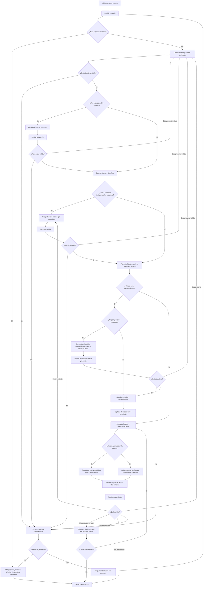
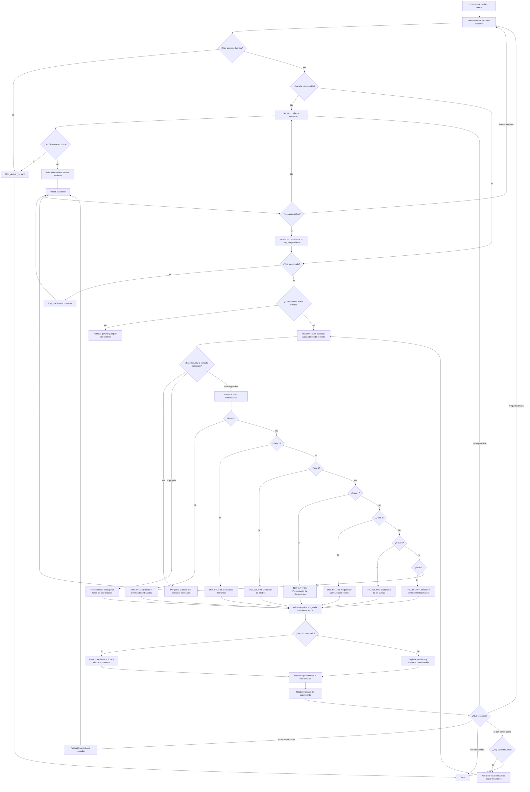
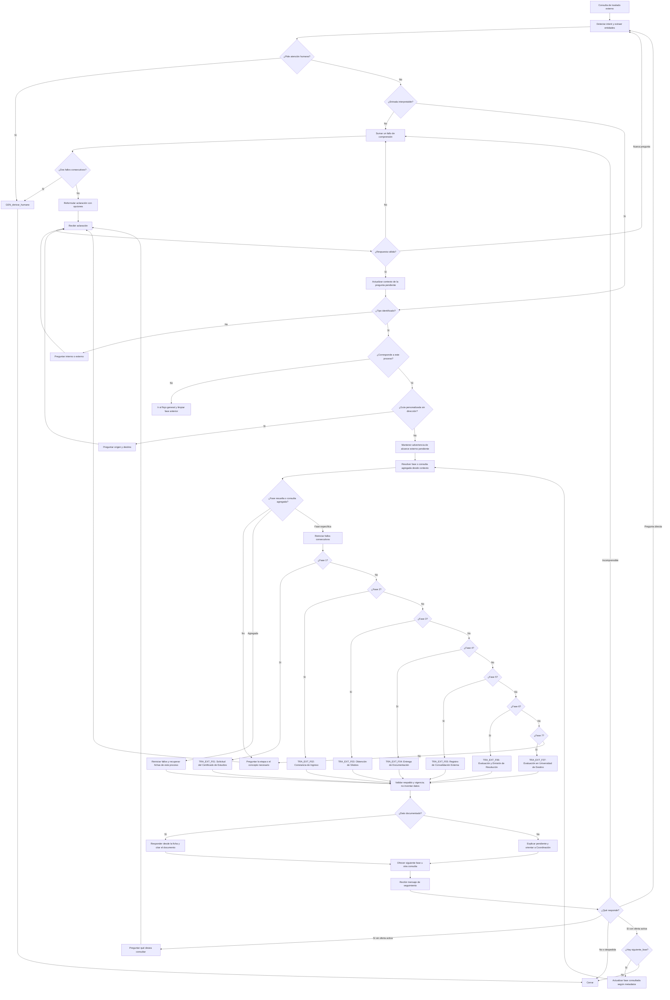

# Diseño conversacional — integrante F

Este archivo diseña respuestas; no ejecuta trámites. Las referencias a pagos, recepción, registro y evaluación describen el material aportado. No se ha validado su vigencia institucional.

## Revisión de fuentes y alcance

Se leyeron completos los dos Markdown, el texto de instrucciones y las dos imágenes adjuntas. Las imágenes muestran un ejemplo de estructura y un flujo conversacional; no aportan nuevas tarifas, contactos ni requisitos para traslados. El correo parcialmente visible pertenece al ejemplo de otro proceso y no se reutiliza. No hay formatos MK entre los cinco archivos recibidos.

| Fuente administrativa | SHA-256 de los bytes revisados |
|---|---|
| `Requisitos_para_Convalidacion_Interna.md` | ecf68cd5d55ce06dfc9373b7aed04ddca13cc9edc800525cc9dc23d6f3b57ce8 |
| `Requisitos_para_Convalidacion_Externa.md` | a379b52383d91ed2926b55e81c77fac2ae793208f6ef4d94a3ff9cc00855115d |

Las fichas 1–7 de cada proceso proceden de las secciones 7–13 de su Markdown. Se contrastaron las secciones 1–6 y 14 para responsables, costos, requisitos, plazos y secuencia. El esquema de metadatos procede del texto de instrucciones adjunto; no se modifica la arquitectura de otros integrantes.

La principal discrepancia de alcance está en el documento externo: describe operaciones en UDH y una evaluación posterior en la universidad de destino, sin declarar inequívocamente origen y destino. Se conserva EXT F07, pero no se presenta como un procedimiento confirmado de ingreso a UDH. Preguntar la dirección al estudiante ayuda a entender su consulta; no subsana la falta de validación oficial. Ambas fuentes describen los mismos tres requisitos y las mismas tarifas; no se inventan diferencias adicionales.

## Contrato de ejecución del diseño

1. Recuperar hechos de `fichas/`; filtrar por proceso antes de responder. `estado: pendiente` permite citar lo descrito en la fuente con atribución, pero impide presentarlo como norma vigente confirmada.
2. Resolver el tipo cuando cambie la respuesta. Una comparación explícita permite consultar ambos procedimientos. Preguntar fase solo cuando sea indispensable; documento e intención pueden resolverla.
3. Mantener `tipo_traslado`, `fase_activa`, `oferta_siguiente`, `fallos_consecutivos` y menciones del usuario. La fase activa representa navegación, no evidencia de avance del expediente.
4. Tras una respuesta comprendida con las entidades indispensables resueltas, reiniciar fallos a 0. Cada entrada incomprendida o aclaración inválida suma 1. Al llegar a 2, ejecutar `GEN_derivar_humano` sin un tercer intento. Si la respuesta siguiente es otra pregunta válida, atenderla y reiniciar el contador.
5. `Sí` solo avanza cuando hay una oferta de siguiente etapa y una fase activa. `No` ante esa oferta cierra. Un cambio explícito de pregunta tiene prioridad sobre avanzar. Si cambia el tipo de traslado, limpiar la fase anterior.
6. La falta documental no es un fallo de comprensión. Informar el pendiente y orientar a la dependencia conocida; no forzar dos preguntas que no resolverán una ausencia de fuente.
7. La derivación es orientación: no hay canal oficial confirmado ni transferencia automática. No pedir DNI, contraseña, tarjeta ni información sensible para responder.
8. En externo, para una guía personalizada preguntar origen/destino y mantener la advertencia de alcance. Las consultas factuales pueden contestarse citando el documento, sin exigir la dirección si no cambia el hecho consultado.

## 1. Flujo conversacional general



`AA` usa la ficha resuelta en `S` o `AH`. Al entrar desde `AH`, mantener las restricciones de alcance externo ya informadas. Una respuesta factual sobre dos procedimientos se construye de forma comparativa y no mezcla sus fases.

## 2. Flujo conversacional de traslado interno

Las siete etapas se consultan por pregunta directa o siguiendo `siguiente_fase`. El selector permite saltar a cualquier etapa del proceso interno; ninguna consulta exige completar las anteriores.



| Ficha activa | Al pedir la siguiente etapa |
|---|---|
| `TRA_INT_F01` | `TRA_INT_F02` |
| `TRA_INT_F02` | `TRA_INT_F03` |
| `TRA_INT_F03` | `TRA_INT_F04` |
| `TRA_INT_F04` | `TRA_INT_F05` |
| `TRA_INT_F05` | `TRA_INT_F06` |
| `TRA_INT_F06` | `TRA_INT_F07` |
| `TRA_INT_F07` | Fin del procedimiento documentado; ofrecer otra consulta. |

El contador aumenta solo ante una entrada incomprensible o una respuesta inválida a la aclaración. Preguntar por primera vez un tipo, fase o concepto que falta no suma un fallo. El contexto conserva la pregunta pendiente al recibir una aclaración válida. Un cambio a otro tipo de traslado regresa al flujo general, borra la fase activa y selecciona las fichas del nuevo proceso.

## 3. Flujo conversacional de traslado externo

Las siete etapas se consultan por pregunta directa o siguiendo `siguiente_fase`. El selector permite saltar a cualquier etapa del proceso externo; ninguna consulta exige completar las anteriores.



| Ficha activa | Al pedir la siguiente etapa |
|---|---|
| `TRA_EXT_F01` | `TRA_EXT_F02` |
| `TRA_EXT_F02` | `TRA_EXT_F03` |
| `TRA_EXT_F03` | `TRA_EXT_F04` |
| `TRA_EXT_F04` | `TRA_EXT_F05` |
| `TRA_EXT_F05` | `TRA_EXT_F06` |
| `TRA_EXT_F06` | `TRA_EXT_F07` |
| `TRA_EXT_F07` | Fin del procedimiento documentado; ofrecer otra consulta. |

El contador aumenta solo ante una entrada incomprensible o una respuesta inválida a la aclaración. Preguntar por primera vez un tipo, fase o concepto que falta no suma un fallo. El contexto conserva la pregunta pendiente al recibir una aclaración válida. Un cambio a otro tipo de traslado regresa al flujo general, borra la fase activa y selecciona las fichas del nuevo proceso.

## Convenciones de integración y pruebas

`intents.yaml` contiene un objeto con `entidades` y una lista `intents`. Cada intent conserva los campos del contrato; `ficha_relacionada` es una lista de candidatos existentes, filtrados según las reglas del mismo archivo. No se usan comodines sin resolver. Los IDs de acciones empiezan por `TRA_ACC_`; solo `GEN_derivar_humano` conserva el prefijo general convenido.

`golden_set.csv` tiene exactamente cinco columnas. TRA_Q01–TRA_Q15 cubren interno y TRA_Q16–TRA_Q30 externo. Las preguntas ambiguas de cada bloque nombran el tipo pero omiten el concepto o fase. `NO_APLICA` indica que primero corresponde una aclaración y todavía no se recupera una ficha. Cuando se pide siguiente fase, `ficha_esperada` apunta a la ficha de destino. Si una comparación necesita varias fichas, sus IDs se separan con `|` dentro de la misma celda CSV. Las respuestas clave son hechos mínimos y restricciones que deben preservarse, no coincidencias literales obligatorias. El conjunto no prueba un modelo entrenado: solo establece los resultados esperados.

Pruebas conversacionales adicionales que debe ejecutar la futura implementación: dos respuestas incomprensibles consecutivas llevan a GEN_derivar_humano; una aclaración válida reinicia el contador; un sí sin oferta no avanza; una pregunta directa puede saltar de F01 a F05; cambiar de interno a externo limpia fase; una dirección externa autodeclarada no confirma el alcance oficial; una solicitud de ver expediente no genera un estado ficticio. No se atribuye ejecución de estas pruebas a un chatbot inexistente.

## Inventario final y verificaciones

El paquete contiene exclusivamente los 19 archivos del contrato del integrante F. Los scripts temporales de construcción y validación no forman parte de la entrega. Los adjuntos de referencia permanecen intactos y no se incluyen copias adicionales en la estructura acordada.

```text
fase2/
└── traslados_generales/
    ├── fichas/
    │   ├── TRA_INT_F01.md
    │   ├── TRA_INT_F02.md
    │   ├── TRA_INT_F03.md
    │   ├── TRA_INT_F04.md
    │   ├── TRA_INT_F05.md
    │   ├── TRA_INT_F06.md
    │   ├── TRA_INT_F07.md
    │   ├── TRA_EXT_F01.md
    │   ├── TRA_EXT_F02.md
    │   ├── TRA_EXT_F03.md
    │   ├── TRA_EXT_F04.md
    │   ├── TRA_EXT_F05.md
    │   ├── TRA_EXT_F06.md
    │   └── TRA_EXT_F07.md
    ├── intents.yaml
    ├── flujo.md
    ├── plantillas.md
    ├── golden_set.csv
    └── pendientes.md
```

| Elemento | Cantidad |
|---|---:|
| Fichas internas | 7 |
| Fichas externas | 7 |
| Intents | 17 |
| Ejemplos por intent | 10 |
| Ejemplos de intents en total | 170 |
| Entidades | 8 |
| Ejemplos de extracción por entidad | 10 |
| Diagramas Mermaid | 3 |
| Plantillas | 23 |
| Preguntas del Golden Set | 30: 15 internas y 15 externas |
| Pendientes | 32: 15 internos y 17 externos |

Verificación automatizada: encabezados YAML parseables; campos y secciones obligatorios presentes; IDs sin duplicados; referencias y enlaces locales existentes; siguiente fase correcta; un único GEN_derivar_humano; diez ejemplos únicos por intent; CSV de cinco columnas y treinta filas de datos; referencias del Golden Set existentes; comprobaciones de tarifas y transiciones clave coherentes con las fichas; huellas de los Markdown originales sin cambios; estructura exclusiva del integrante F.

Los tres diagramas pasaron una comprobación estructural del subconjunto Mermaid utilizado: definiciones de nodos, conexiones, etiquetas, alcance desde inicio y ruta de derivación. No se ejecutó un renderizador Mermaid ni se verificó la visualización en GitHub. Las preguntas del Golden Set son especificaciones de resultado esperado; no se han ejecutado contra un chatbot, que no forma parte del encargo.
