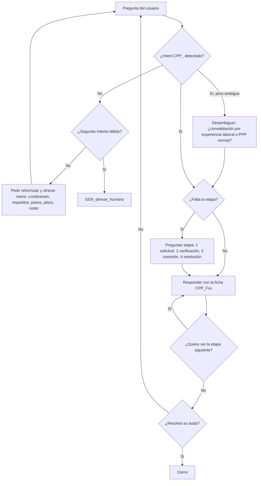
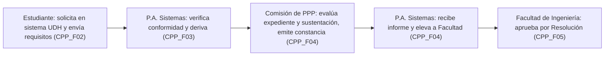

# Flujo conversacional — Convalidación de PPP por experiencia laboral (CPP_)

## 1. Flujo del asistente

**Regla de derivación:** tras dos intentos fallidos se usa `GEN_derivar_humano` (definido por F).

## 2. Flujo del proceso (referencia para las respuestas)

## 3. Desambiguación

| Situación | Pregunta del bot |
|---|---|
| El usuario dice solo "convalidar" | "¿Te refieres a convalidar la PPP por experiencia laboral, o por traslado?" (si es traslado, derivar a TRA_) |
| El usuario dice solo "prácticas" | "¿Quieres información de las prácticas preprofesionales normales (PPP_) o de convalidarlas con tu trabajo (CPP_)?" |
| El usuario dice "proceso" sin más | "¿Quieres el resumen completo o una etapa? (1 solicitud, 2 verificación, 3 comisión, 4 resolución)" |

## 4. Conversaciones de ejemplo

**Caso A: respuesta directa**
- Usuario: ¿Qué documentos necesito para convalidar mi PPP por trabajo?
- Bot: (CPP_requisitos → CPP_F02) lista de 5 documentos + correo de envío + plazo de 20 días para el informe. "¿Quieres ver qué pasa después de enviarlos?"
- Usuario: Sí.
- Bot: (CPP_F03) El Programa Académico verifica y deriva a la Comisión de PPP. "¿Seguimos con la etapa de la Comisión?"
- Usuario: No, gracias.
- Bot: Cierre.

**Caso B: falta la etapa**
- Usuario: Explícame el proceso.
- Bot: "¿Quieres el resumen completo o una etapa? (1 solicitud, 2 verificación, 3 comisión, 4 resolución)"
- Usuario: La 3.
- Bot: (CPP_F04) La Comisión evalúa el expediente y la sustentación y emite su constancia de aprobación.

**Caso C: fallback y derivación**
- Usuario: ¿Me conviene más convalidar o hacer prácticas?
- Bot: (intento 1) "No tengo información para comparar. ¿Quieres saber las condiciones, requisitos, pasos, plazo o costo de la convalidación?"
- Usuario: Dime cuál es mejor para mí.
- Bot: (intento 2) → `GEN_derivar_humano`.
