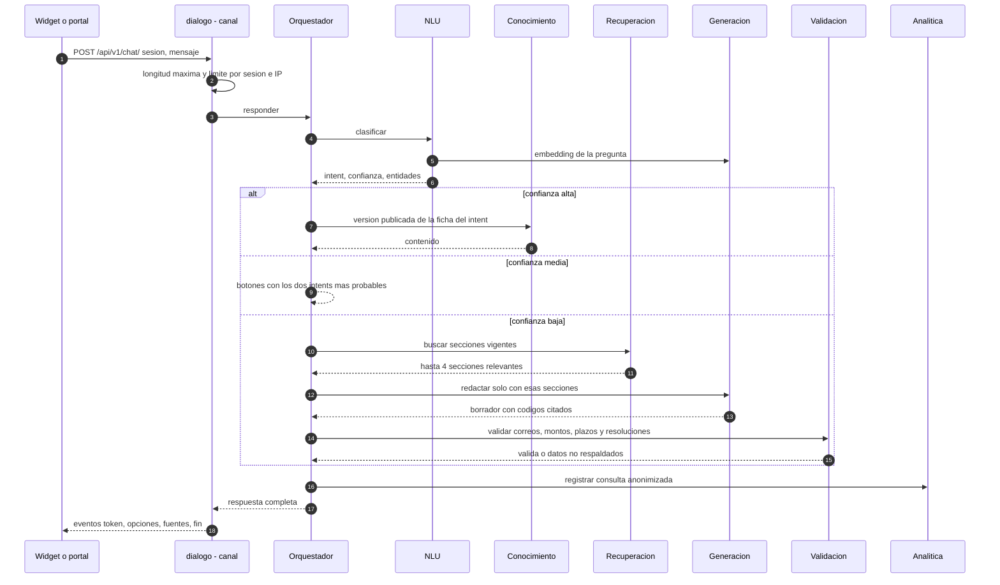

# Flujo de una consulta

Recorrido de un mensaje del estudiante desde el widget hasta la respuesta. El código está en `backend/apps/dialogo/orquestador.py`.

## Vías

| Confianza del intent | Vía | Qué responde | Llama al LLM |
|---|---|---|---|
| ≥ 0,75 | Determinista | Las secciones de la ficha que el intent pide (`Intent.secciones`) | No |
| ≥ 0,75 y falta la fase | Aclaración | `si_falta_entidad` del intent, con botones por fase | No |
| 0,40 a 0,75 | Desambiguación | Botones con los dos intents más probables | No |
| < 0,40 | RAG | Redacción con las secciones recuperadas, citando el código | Sí, si hay presupuesto |
| 2 intentos fallidos, validación fallida o pedido explícito | Derivación | Contacto de Coordinación (texto de Configuración) | No |

Los umbrales son los iniciales del diseño de la Fase 2 y se ajustan desde el panel (Configuración) después de calibrarlos con el golden set.

## Reglas que garantizan que no se invente nada

1. La vía determinista copia el texto de una **versión publicada**; no hay generación.
2. La vía RAG solo recibe secciones de fichas publicadas, vigentes y no reemplazadas.
3. Si ninguna sección supera la similitud mínima, no se llama al LLM: se cuenta un intento fallido.
4. La respuesta del LLM se valida **completa** antes de enviarse (ADR-0006). Un dato sin respaldo descarta la respuesta y deriva.
5. Si el LLM no está disponible (error del proveedor, límite de gasto o apagado desde el panel), la vía RAG arma la respuesta copiando las secciones recuperadas, sin redactar.

## Eventos SSE

| Evento | Datos | Cuándo |
|---|---|---|
| `token` | `{"t": "…"}` | Fragmentos del texto, en orden |
| `opciones` | `{"opciones": [{"etiqueta", "intent"?, "ficha"?, "mensaje"?}]}` | Desambiguación, aclaración, siguiente fase, accesos rápidos |
| `fuentes` | `{"fichas": [{"codigo", "titulo", "proceso"}]}` | Fichas citadas |
| `fin` | `{"consultaId", "via", "derivada"}` | Siempre al final; `consultaId` sirve para «¿Le fue útil?» |
| `error` | `{"mensaje"}` | Falla interna; el texto es apto para mostrarse al estudiante |

Al pulsar una opción, el cliente reenvía su `intent` o su `ficha`; el orquestador los usa con confianza 1 en lugar de volver a clasificar. Los tipos TypeScript de estos eventos están en `frontend/projects/shared/src/lib/models/chat.model.ts`.
