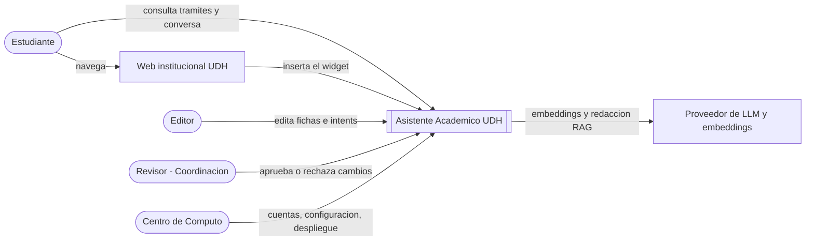
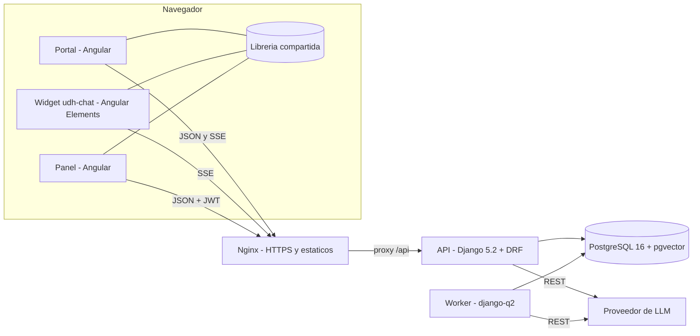
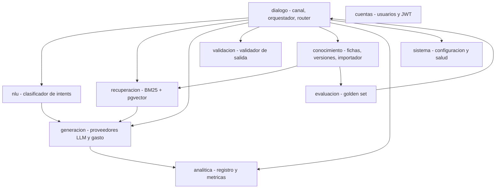

# Modelo C4

El modelo formal está en [`workspace.dsl`](workspace.dsl) (Structurizr DSL) y es la fuente de verdad: de él salen las vistas navegables y contra él se valida el código en el CI (`scripts/validar_c4.py`). Este documento lo explica nivel por nivel con diagramas Mermaid que se leen directamente en GitHub.

Para ver el modelo interactivo:

```bash
docker run -it --rm -p 8080:8080 -v "$PWD/docs/03-arquitectura/modelo-c4:/usr/local/structurizr" structurizr/lite
```

## Nivel 1 · Contexto

Quién usa el sistema y con qué sistemas externos se relaciona.



| Elemento | Responsabilidad |
|---|---|
| Asistente Académico UDH | Portal de consultas, asistente conversacional y panel de mantenimiento. |
| Proveedor de LLM | Único servicio externo. Calcula embeddings y redacta respuestas abiertas. Es intercambiable (ADR-0004). |
| Web institucional | Opcional: puede insertar el widget con dos líneas de HTML. El sistema no depende de ella (ADR-0009). |

## Nivel 2 · Contenedores



| Contenedor | Tecnología | Responsabilidad | Ruta |
|---|---|---|---|
| Portal | Angular 22 | Sitio público: trámites, fases, documentos, buscador, asistente. | `frontend/projects/portal` |
| Widget | Angular Elements | `<udh-chat>` con Shadow DOM para cualquier página. | `frontend/projects/widget` |
| Panel | Angular 22 | Mantenimiento del conocimiento y calidad. Solo personal con cuenta. | `frontend/projects/admin` |
| Librería compartida | Angular library | Modelos del dominio, cliente SSE y componente de conversación. | `frontend/projects/shared` |
| API | Django 5.2 + DRF | Canal del chat, endpoints públicos y del panel. | `backend` |
| Worker | django-q2 | Indexación, prueba de humo, golden set, propuestas de fichas, purga. | `backend` (mismo código) |
| Base de datos | PostgreSQL 16 + pgvector | Datos, embeddings con índice HNSW, cola de tareas y caché. | — |
| Servidor web | Nginx | HTTPS, archivos de las tres SPA, proxy a la API, documentos subidos. | `infra/nginx` |

Hay una sola base de datos y ningún servicio de IA propio: es lo que mantiene bajo el costo de operación (ADR-0005).

## Nivel 3 · Componentes de la API

Cada componente es una app de Django en `backend/apps/`.



La responsabilidad, las dependencias permitidas y las reglas de cada componente están en [`../modulos.md`](../modulos.md).

## Nivel 3 · Componentes del panel y del portal

| Contenedor | Componente (feature) | Ruta |
|---|---|---|
| Panel | auth, dashboard, conocimiento, intents, pendientes, documentos, calidad, probador, evaluacion, conversaciones, usuarios, configuracion | `frontend/projects/admin/src/app/features/<feature>` |
| Portal | inicio, tramite, documentos, buscar, asistente, acerca | `frontend/projects/portal/src/app/features/<feature>` |

Cada feature tiene `pages/` (componentes enrutables) y, si consume la API, `data-access/` (servicios HTTP). Ningún componente llama a `HttpClient` directamente.

## Nivel 4 · Código

El nivel de código no se dibuja a mano: se desactualizaría con el primer cambio. Sus fuentes son:

- el modelo de datos: [`../modelo_datos.md`](../modelo_datos.md);
- el contrato de la API: [`../api/openapi.yaml`](../api/openapi.yaml), generado desde el código con `python manage.py spectacular`;
- el flujo de una consulta: [`../flujo_consulta.md`](../flujo_consulta.md).

## Regla de mantenimiento

Quien crea, renombra o elimina una app de Django o una feature de Angular actualiza `workspace.dsl` **en el mismo Pull Request**. El CI ejecuta `python scripts/validar_c4.py`, que falla si una ruta del código no tiene elemento en el modelo o si el modelo apunta a una ruta que ya no existe.
