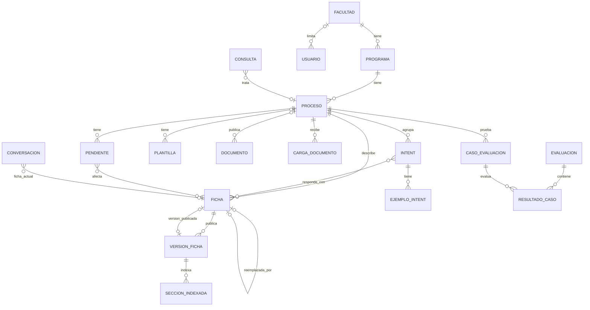
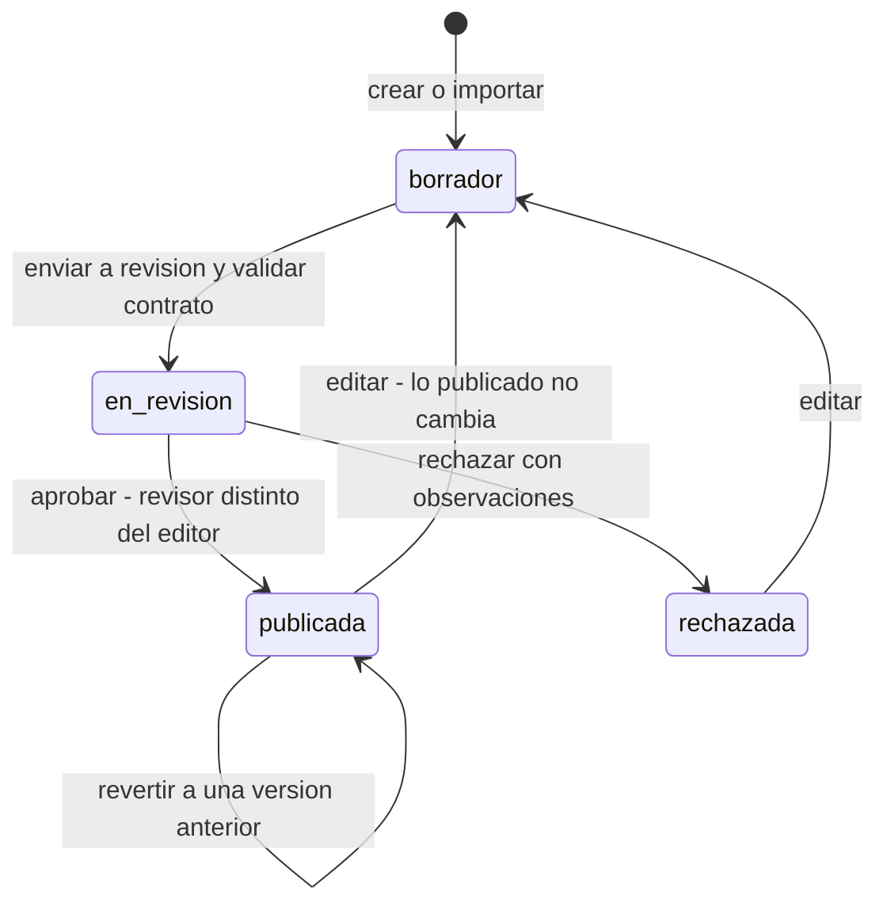

# Modelo de datos

Fuente: los `models.py` de cada app. Las migraciones están en `backend/apps/<app>/migrations/` y el CI comprueba que no falte ninguna (`makemigrations --check`).

## Entidades

| Entidad | App | Propósito | Reglas |
|---|---|---|---|
| `Facultad`, `Programa`, `Proceso` | conocimiento | Jerarquía que permite escalar a toda la universidad. | `Proceso.clave` es única por programa; `prefijos` define qué códigos le pertenecen. |
| `Ficha` | conocimiento | **Borrador** editable de una fase. | `codigo` único por proceso y no cambia una vez publicado. Seis secciones obligatorias para enviar a revisión. |
| `VersionFicha` | conocimiento | Copia **inmutable** de lo publicado. Lo que responde el asistente y muestra el portal. | Numeración correlativa por ficha. Nunca se edita ni se borra. |
| `Intent`, `EjemploIntent` | conocimiento | Intención del estudiante y sus ejemplos con embedding. | `secciones` limita lo que muestra la vía determinista. |
| `Plantilla`, `Pendiente` | conocimiento | Textos reutilizables y datos por confirmar con Coordinación. | Resolver un pendiente no modifica fichas. |
| `Documento` | conocimiento | Biblioteca normativa del portal. | Archivo .pdf/.docx validado por firma o enlace externo. |
| `CargaDocumento` | conocimiento | Documento subido para proponer fichas en borrador. | Las fichas propuestas siempre quedan en borrador. |
| `SeccionIndexada` | recuperacion | Una sección de una versión publicada, con su embedding (768, HNSW coseno). | Al publicar, las anteriores pasan a `vigente=False`. Guarda el proveedor del embedding. |
| `Conversacion` | dialogo | Estado del diálogo de una sesión anónima. | La sesión es un UUID del navegador. |
| `Consulta` | analitica | Registro de cada pregunta y respuesta. | Pregunta enmascarada; se purga a los 12 meses. |
| `CasoEvaluacion`, `Evaluacion`, `ResultadoCaso` | evaluacion | Golden set y sus ejecuciones. | Una evaluación puede ser manual o una prueba de humo tras publicar. |
| `Usuario` | cuentas | Cuenta del personal. | Rol jerárquico; `facultad` vacía = todas. |
| `Configuracion` | sistema | Parámetros editables desde el panel. | Fila única (pk = 1). |

## Ciclo de vida de una ficha

Al aprobar se crea una `VersionFicha`, el worker indexa sus secciones y corre una prueba de humo con tres casos del golden set del proceso. Si la prueba detecta datos inventados, se vuelve automáticamente a la versión anterior.
