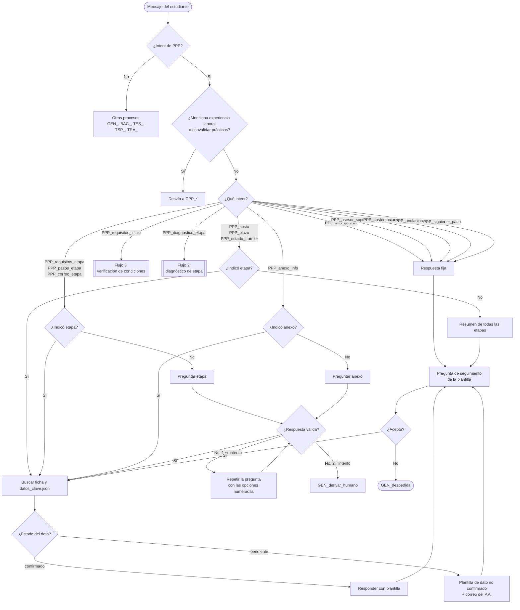
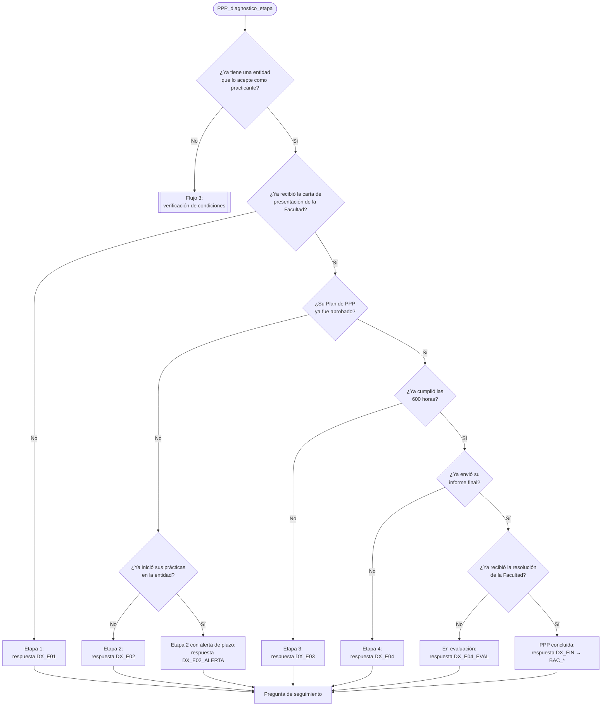
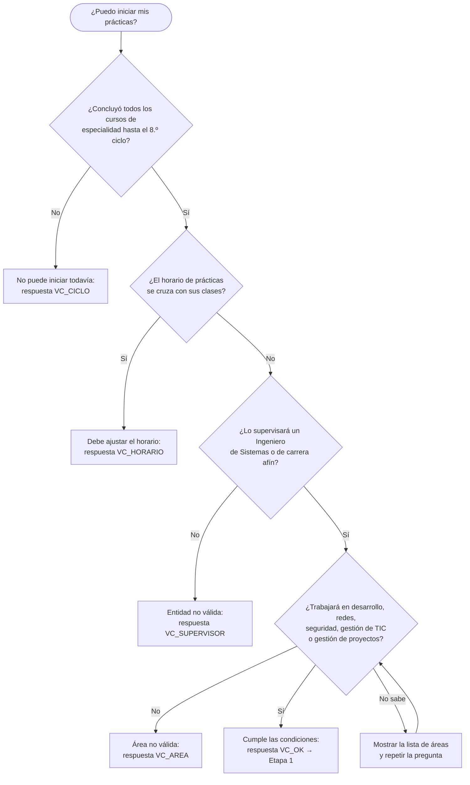

# Flujo conversacional — PPP

El proceso tiene tres flujos:
1. **Flujo principal:** atiende las 14 intenciones de PPP.
2. **Flujo de diagnóstico de etapa:** guía al estudiante que no sabe qué le toca hacer.
3. **Flujo de verificación de condiciones:** confirma si el estudiante puede iniciar las prácticas.

---

## 1. Flujo principal

---

## 2. Flujo de diagnóstico de etapa

Se activa con `PPP_diagnostico_etapa`. Hace preguntas de sí o no, en orden, y se detiene en la primera respuesta «no».

Si el estudiante responde algo distinto de sí o no dos veces seguidas, pasa a `GEN_derivar_humano`.

---

## 3. Flujo de verificación de condiciones

Se activa con `PPP_requisitos_inicio` cuando el estudiante pregunta si **él** puede iniciar («¿puedo empezar?»). Si solo pide la lista de condiciones, se responde directamente con la plantilla `PPP_requisitos_inicio`.

---

## Reglas del flujo

| Situación | Comportamiento |
|---|---|
| Pregunta requisitos, pasos o correo sin indicar la etapa | Se pregunta la etapa con las 4 opciones numeradas |
| Pregunta costo, plazo o estado sin etapa | No se pregunta: se muestra el resumen de todas las etapas |
| Pregunta por un anexo sin número | Se pregunta el anexo mostrando la lista 02, 03, 04, 05, 06, 07 y 10 |
| Pregunta por el Anexo 01 | Se indica que no se exige |
| Pregunta por los Anexos 08 o 09 | Desvío a `CPP_*` |
| Menciona que ya trabaja o quiere convalidar | Desvío a `CPP_*` antes de responder |
| Pide el correo de la Etapa 3 | Se aclara que en esa etapa el estudiante no envía documentos |
| Dos respuestas no reconocidas seguidas | `GEN_derivar_humano` |
| El dato está marcado como pendiente | Plantilla de dato no confirmado, con el correo del P.A. |
| Termina una respuesta de etapa | Se ofrece la etapa siguiente (campo `Siguiente fase` de la ficha) |
| El estudiante responde la etapa con un número (1 a 4) | Se acepta como valor de la entidad `etapa` |
| El mensaje ya responde una pregunta de los flujos 2 o 3 (por ejemplo, «estoy en séptimo ciclo») | Se omite esa pregunta y se usa la respuesta dada |

---

## Ejemplos de conversación

**Desambiguación de etapa**
> **Estudiante:** a qué correo mando mis documentos de prácticas
>
> **Chatbot:** El correo cambia según la etapa. ¿Para cuál lo necesita? 1) Carta de presentación, 2) Plan de PPP o 4) Informe final.
>
> **Estudiante:** el plan
>
> **Chatbot:** Para la Etapa 2, Plan de PPP, envíe sus documentos a comision.practicas.isi@udh.edu.pe. Tiene como máximo 15 días calendario desde el inicio de su práctica para presentarlo.
> ¿Desea ver los requisitos del Plan de PPP?

**Diagnóstico de etapa**
> **Estudiante:** no sé qué me toca hacer en mis prácticas
>
> **Chatbot:** Le ayudo a ubicar su etapa. ¿Ya tiene una entidad que lo acepte como practicante?
>
> **Estudiante:** sí
>
> **Chatbot:** ¿Ya recibió la carta de presentación de la Facultad?
>
> **Estudiante:** sí
>
> **Chatbot:** ¿Su Plan de PPP ya fue aprobado?
>
> **Estudiante:** no
>
> **Chatbot:** ¿Ya inició sus prácticas en la entidad?
>
> **Estudiante:** sí, hace una semana
>
> **Chatbot:** Usted está en la Etapa 2, Plan de PPP. Tiene como máximo 15 días calendario desde el inicio de su práctica para presentar el Plan, así que le recomiendo enviarlo cuanto antes a comision.practicas.isi@udh.edu.pe.
> ¿Desea ver los requisitos del Plan?

**Dato no confirmado**
> **Estudiante:** cuánto se paga por el plan
>
> **Chatbot:** Ese dato aún no está confirmado en la información oficial. Para no darle información incorrecta, le recomiendo consultarlo en secretaria.sistemas.hco@udh.edu.pe.

**Desvío a otro proceso**
> **Estudiante:** trabajo hace 2 años en sistemas, igual tengo que hacer prácticas
>
> **Chatbot:** Si usted ya trabajó 16 meses o más en labores de la especialidad, puede convalidar sus prácticas en lugar de realizarlas. ¿Desea conocer ese trámite?
